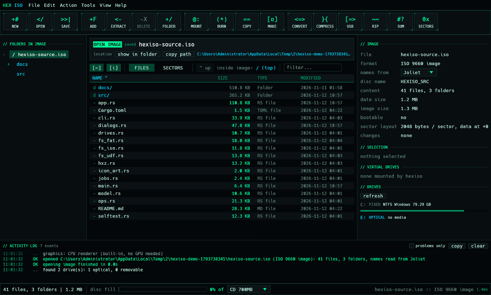
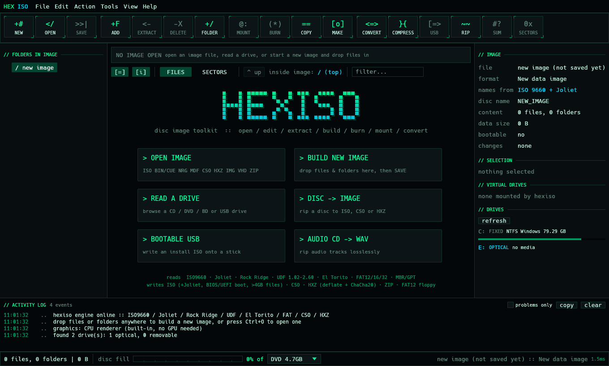
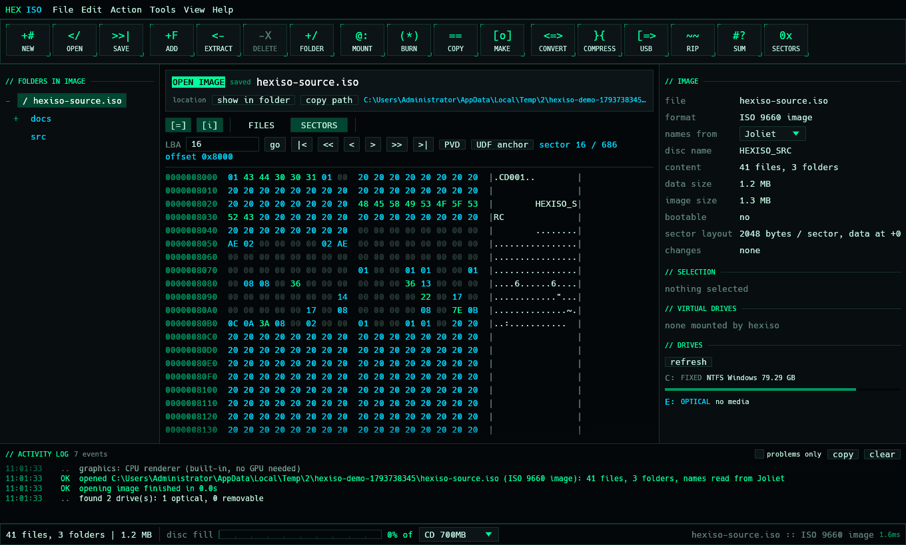

# HEXISO

**A fast, portable disc image toolkit written in Rust.**
Open, browse, extract, edit, build, convert, compress, encrypt, split, checksum, mount and burn
CD / DVD / Blu-ray images from one `hexiso.exe`, through a dark terminal-style window or a
scriptable command line.

[](https://github.com/Altair47/hexiso/actions/workflows/ci.yml)
[](https://github.com/Altair47/hexiso/releases)
[](LICENSE)

Created by **Nick Petropoulos** · [github.com/Altair47](https://github.com/Altair47) ·
Free software under the [GNU AGPL-3.0](LICENSE) · **[Download the latest release](https://github.com/Altair47/hexiso/releases/latest)**



| Start screen | Sector viewer |
|---|---|
|  |  |

**Contents:** [Features](#features) · [Supported formats](#supported-formats) ·
[Install](#install) · [Using the window](#using-the-window) · [Command line](#command-line) ·
[How it is built](#how-it-is-built) · [Windows-only parts & Linux port](#platform-support-what-is-windows-only) ·
[Building from source](#building-from-source) · [Testing](#testing) · [Releasing (package.ps1)](#releasing-packageps1) ·
[Limitations](#limitations) · [Contributing](#contributing) · [License & credits](#license--credits)

---

## Features

| | |
|---|---|
| **Open & browse** | Disc images, disk images, compressed images, split images and ZIP archives (see [Supported formats](#supported-formats)). Folder tree, sortable file list, filter, search across all folders. |
| **Edit** | Add / delete / rename files and folders, create folders, drag & drop, change the volume label, add or remove boot images. Changes stay in memory until you save. |
| **Build** | New ISO 9660 + Joliet images (long Unicode names, files over 4 GB), BIOS and UEFI bootable images, FAT12 floppy images, ZIP archives. |
| **Convert & compress** | Any readable disc image to plain ISO, CSO (compressed ISO) or HXZ (compressed, optionally password-encrypted). Compression runs on all CPU cores. |
| **Extract** | Single files, folders or everything, with progress, speed, ETA and cancel. |
| **Mount** | Mounts an image as a virtual DVD drive with Windows' built-in mounter (no driver to install). Detects images that are already mounted and offers remount / mount another copy / eject all. |
| **Burn & copy** | Burns an image to CD / DVD / BD with the Windows Disc Image Burner; copies a disc (read to a temporary ISO, then burn). |
| **Drives** | Make an image from a disc or USB drive, browse a drive directly, rip audio CDs to WAV. |
| **Bootable USB** | Copies an install image's files onto a USB stick, optionally formatting it as FAT32 / NTFS / exFAT first. |
| **Tools** | CRC32 / MD5 / SHA-1 / SHA-256 checksums (of an image or a single file inside it), image test (reads every file back), file splitting into volumes, raw sector / hex viewer, activity log. |
| **Command line** | Every main feature as a command, with `--json` output and exit codes for scripts. |

---

## Supported formats

### Image files it can open (read)

These are the "readable images" that `convert`, `info`, `ls`, `extract`, `mount` and the window
accept. The file type is detected from its content, not just its extension.

| Format | Extensions | What is supported |
|---|---|---|
| ISO (2048-byte sectors) | `.iso`, `.img`, `.udf` | Fully. |
| Raw CD images | `.bin`, `.img`, `.raw` | 2352-byte Mode 1 and Mode 2 (XA form 1) sectors and 2336-byte Mode 2, detected automatically. Only the data part of each sector is used. |
| CUE sheets | `.cue` | Reads the first `FILE` and the first data track (`MODE1/2048`, `MODE1/2352`, `MODE2/2352`, `MODE2/2336`). Multi-file sheets, extra tracks and audio-only discs are not supported. |
| Nero images | `.nrg` | Images with the usual fixed header (data at 300 KB, 2048 or 2352 bytes per sector). The NRG footer / track table is not parsed, so unusual multi-session NRGs may not open. |
| Alcohol images | `.mdf` | 2048, 2352 and 2448-byte (with subchannel) sectors. The `.mds` descriptor is not needed and not read. |
| Images with a 32 KB header | any | Detected automatically. |
| Virtual hard disks | `.vhd` | Fixed-size VHD only (dynamic / differencing VHD, VHDX, VMDK and VDI are not supported for browsing; Windows can still mount `.vhd` / `.vhdx` directly). |
| Floppy & hard disk images | `.img`, `.ima`, `.flp` | Raw images with a FAT file system or an MBR / GPT partition table. |
| CSO (compressed ISO) | `.cso` | Version 1, deflate blocks, any block size and index alignment. |
| HXZ (this app's own format) | `.hxz` | Compressed and optionally encrypted images (see [HXZ format](#the-hxz-format)). |
| Split volumes | `.001` (+ `.002`, `.003`...) | Any of the above split into numbered parts; open the `.001` and the parts are read as one file. |
| ZIP archives | `.zip` | Browse and extract (all common compression methods). Not usable as a source for `convert` or `mount`, since a ZIP isn't a disc image. |
| Physical drives (Windows) | `D:` etc. | CD / DVD / BD discs and USB sticks, read sector by sector (unreadable sectors are zero-filled). |

### File systems inside images (read)

| File system | Notes |
|---|---|
| **ISO 9660** | Levels 1-3, multi-extent files (over 4 GB), hidden files. |
| **Joliet** | Unicode names (UCS-2), the usual Windows name table. |
| **Rock Ridge** | Long, case-sensitive Linux names (`NM` entries, including continuation areas). Unix permissions, symlinks and deep-directory relocation are not interpreted. |
| **UDF** | Revisions 1.02-2.60: physical and metadata partitions, short / long / extended allocation descriptors, inline (embedded) files, sparse extents. Used by Windows install discs, DVD-Video and Blu-ray. Sparable / virtual partitions (rewritable discs) are read as physical, which works for most finalised discs. |
| **El Torito boot** | Boot catalog with BIOS and UEFI entries and multiple sections; boot images that are also files, or hidden; "boot info table" detection; extract boot images. |
| **FAT12 / FAT16 / FAT32** | With long file names. |
| **MBR / GPT partitions** | Each partition is shown as a folder; only FAT partitions can be browsed. |

When a disc has several name tables (for example UDF + Joliet + ISO 9660), HEXISO picks the
richest one and lets you switch with **names from** in the right panel or `--fs` on the command
line. Switching only changes how names are read; the image isn't touched.

### Formats it can write

| Output | Command / where | Details |
|---|---|---|
| **ISO** | Save / `create` / `convert` | ISO 9660 + Joliet. ISO 9660 names are uppercase, up to 30 characters (`NAME.EXT;1`); Joliet names keep the real name (Unicode, up to 103 characters). Files over 4 GB use multi-extent records. Optional El Torito boot: BIOS (no emulation) and / or UEFI, with boot-info-table patching for ISOLINUX. Rock Ridge and UDF are **not** written. |
| **CSO** | Save / `create` / `convert` | CSO v1, 2048-byte blocks, deflate, multi-core. |
| **HXZ** | Save / `create` / `convert` | Compressed (deflate) and optionally encrypted. |
| **ZIP** | Save / `create` | Deflate, ZIP64 for big files. |
| **Floppy IMG** | Make floppy / `floppy` | FAT12, 1.44 MB or 2.88 MB, long file names, sub-folders. |
| **Split volumes** | Split / `split` | `name.001`, `name.002`, ... of any size. |
| **WAV** | Rip audio CD / `rip` | 44.1 kHz, 16-bit stereo, one file per track. |

`convert` always writes the image *as it is* (sector for sector) into the new container: BIN/CUE,
NRG, MDF, VHD, CSO, HXZ or split images become a plain 2048-byte-sector ISO (or CSO / HXZ).
Audio tracks and subchannel data are dropped.

### The HXZ format

HXZ is HEXISO's own container, a modern open replacement for proprietary compressed or encrypted
image formats:

* 96-byte header (`HXZ1`, flags, block size, original size, block count, index offset, salt, password check),
  then the data blocks, then an index of `(offset, length, compressed?)` per block.
* The image is cut into 64 KiB blocks, each deflate-compressed (or stored when that is smaller), so
  any sector can be read without unpacking the rest. That is why `.hxz` files open, browse and
  mount-convert quickly.
* With a password: key = PBKDF2-HMAC-SHA256 (200,000 iterations, random 16-byte salt); every block is
  sealed with ChaCha20-Poly1305 (nonce = block number), so tampering or a wrong password is detected.

---

## Install

HEXISO is a single portable `.exe` (about 17 MB). There's no installer, no settings file and no registry
entries. Temporary copies (made only for mounting, burning or opening a file) go to `%TEMP%\hexiso`
and can be deleted at any time.

* **Portable:** download `hexiso-<version>-win64.zip` from
  [Releases](https://github.com/Altair47/hexiso/releases/latest), unzip it anywhere and run `hexiso.exe`.
* **Scoop:** from the author's bucket
  ```powershell
  scoop bucket add altair47 https://github.com/Altair47/scoop
  scoop install hexiso
  ```
  or straight from the manifest attached to every release:
  `scoop install https://github.com/Altair47/hexiso/releases/latest/download/hexiso.json`.
  (See [Scoop buckets](#scoop-buckets) for how the manifest is maintained.)
* **From source:** see [Building from source](#building-from-source).

Requires Windows 10 or 11, 64-bit.

---

## Using the window

* **Open** an image (or drag one onto the window). The header above the list shows what is open,
  where the file is, and whether there are unsaved changes.
* **New**, then drag files in or press **Add**, then **Save** to write an `.iso` (or `.cso`, `.hxz`,
  `.zip`, floppy `.img`). Nothing is written to disk until you save.
* Double-click a folder to enter it, or a file to open it with its normal Windows program. Right-click for
  extract, rename, delete, checksums, sector view and "use as boot image".
* **Names from** (right panel) switches between the name tables on the disc.
* The window adapts to its size (down to 480 x 340): the toolbar shrinks to icons, the side panels
  fold away (bring them back with `[=]` / `[i]` above the file list or the View menu), table columns
  and status-bar details drop out, and the start screen reflows.
* Hover any button or field for an explanation. Shortcuts: `Ctrl+N` new, `Ctrl+O` open, `Ctrl+S` save,
  `Ctrl+E` extract, `Del` delete, `F2` rename, `Backspace` up, `F5` refresh drives.

---

## Command line

```text
hexiso                          open the window
hexiso <image>                  open the window with an image loaded
hexiso <command> [args] [options]
hexiso help                     full help
```

Paths **inside** an image are written with `/` (or `\`) from the top folder, e.g. `boot/grub/grub.cfg`.
Commands that change an image (`add`, `rm`, `rename`, `mkdir`, `label`, `boot`) save the result
**over the original** (when it's an `.iso`, `.cso`, `.hxz` or `.zip`) unless you pass `--out new.iso`.

| Command | What it does |
|---|---|
| `info <image>` | Format, file system, available name tables, label, file count, sizes, boot entries. |
| `ls <image> [path] [-r]` | List a folder inside the image (`-r`: everything below it). |
| `extract <image> <dest> [paths...]` | Extract everything into `dest`, or only the listed paths (files or folders). |
| `create <out> <files/folders...>` | Build a new image from files and folders on disk. The format comes from the extension: `.iso`, `.cso`, `.hxz`, `.zip`, `.img` (floppy). |
| `add <image> <files/folders...> [--to path]` | Copy files / folders from disk into the image. `--to` is the folder **inside the image** that receives them; it's created if needed. Without `--to` they go to the top folder. Example: `hexiso add backup.iso notes.txt --to docs` puts `notes.txt` into the image's `docs` folder, as `docs/notes.txt`. |
| `rm <image> <paths...>` | Remove files or folders from the image. |
| `rename <image> <path> <new-name>` | Rename one item (keeps it in the same folder). |
| `mkdir <image> <path>` | Create a folder (and any missing parent folders). |
| `label <image> <new-label>` | Change the volume label (the drive name shown when mounted or burned). |
| `boot <image> [--bios f] [--uefi f] [--remove] [--extract dir]` | Without options, list the boot entries. `--bios` / `--uefi` set a boot image: a path inside the image, or a file on disk (stored hidden). `--remove` makes the image non-bootable. `--extract` saves the boot images to a folder. |
| `floppy <out.img> <files...> [--big]` | FAT12 floppy image, 1.44 MB (`--big`: 2.88 MB). |
| `convert <in> <out>` | Any [readable disc image](#image-files-it-can-open-read) to `.iso`, `.cso` or `.hxz` (by extension). `--password` opens an encrypted input; `--encrypt` encrypts an `.hxz` output. |
| `checksum <file> [--in path]` | CRC32 / MD5 / SHA-1 / SHA-256 of a file on disk, or of one file **inside** an image with `--in`. |
| `test <image>` | Read every file back; exit code 1 if any fail. |
| `split <file> --size <MB>` | Split into `file.001`, `file.002`, ... |
| `drives` | List drives (letter, type, file system, label, size). |
| `mounts` | List mounted images and their drive letters. |
| `mount <image> [--again]` | Mount and print the drive letter. If the image is already mounted, prints that letter instead (`--again` adds another drive). Non-ISO formats are converted to a temporary ISO first. |
| `unmount <image>` | Eject every drive made from this image. |
| `burn <image> --drive E` | Open the Windows Disc Image Burner for drive E (non-ISO formats are converted first). |
| `make-image --drive E <out>` | Read a disc or USB drive into `.iso`, `.cso` or `.hxz`. |
| `rip --drive E <dest> [--tracks 1,3]` | Rip audio CD tracks to WAV. |
| `usb <image> --drive F [--format FAT32\|NTFS\|exFAT] --yes` | Copy an install image's files onto a USB stick (refuses non-removable drives unless `--force`; `--yes` is required). |
| `selftest [dir]` | Build, edit, convert, encrypt, split and re-read test images and compare every byte. |

**Options:** `--json` (machine-readable output for `info`, `ls`, `checksum`, `test`, `drives`, `mounts`, `mount`),
`--fs <name>` (read names from `UDF`, `Joliet`, `Rock Ridge`, `ISO 9660` or `FAT`), `--password <pw>`,
`--out <file>`, `--label <name>`, `--bios <path>`, `--uefi <path>`, `--encrypt <pw>`, `-q/--quiet`,
`-h/--help`, `-V/--version`.

**Exit codes:** `0` ok, `1` the operation failed, `2` wrong usage. Progress goes to stderr (only when
it's a terminal), results to stdout, so output can be piped.

```powershell
hexiso info win11.iso --json
hexiso ls ubuntu.iso casper
hexiso extract ubuntu.iso C:\out casper/vmlinuz casper/initrd
hexiso create backup.iso C:\photos C:\docs --label BACKUP
hexiso add backup.iso notes.txt --to docs          # -> docs/notes.txt inside backup.iso
hexiso rm backup.iso docs/old.txt --out backup-v2.iso
hexiso convert game.cue game.iso
hexiso convert big.iso big.hxz --encrypt s3cret
hexiso checksum win11.iso --in sources/install.wim --json
$drive = hexiso mount disk.iso; Get-ChildItem "${drive}:\"
```

---

## How it is built

HEXISO is a single Rust crate (2024 edition). All disc-image work is done by its own code, without
external tools, libraries in C, or the Windows imaging APIs:

```text
          ┌──────────────── window (egui) ───────────────┐   ┌──── command line (cli.rs) ────┐
          │ app.rs · dialogs.rs · theme.rs · jobs.rs      │   │ hexiso info / ls / create ... │
          └───────────────────────┬──────────────────────┘   └───────────────┬───────────────┘
                                  └───────────── ops.rs (open, save, convert, extract, test, checksum, split)
                                                     │
      ┌───────────────────────────┬──────────────────┼────────────────────┬─────────────────────┐
 source.rs                  fs_iso.rs / fs_udf.rs    model.rs           writer.rs              hxz.rs
 containers → 2048-byte     / fs_fat.rs             editable tree      ISO 9660 + Joliet      HXZ + CSO
 sectors (ISO, BIN, NRG,    file systems → tree     (files point at    + El Torito writer     writers (multi-core)
 MDF, VHD, CSO, HXZ, split, (ISO9660, Joliet, RR,   image extents,     (streams files, >4 GB)
 drives)                    UDF, El Torito, FAT)    disk files, ZIP)
                                                     │
                                                drives.rs  (OS layer: drive list, mount, burn, rip)
```

1. **Containers** (`source.rs`, `hxz.rs`): every image format is turned into one interface, "a run of
   2048-byte sectors", using positioned reads (no seeking, safe across threads). Raw BIN / MDF sectors
   are unwrapped; CSO and HXZ blocks are decompressed on demand with a one-block cache.
2. **File systems** (`fs_iso.rs`, `fs_udf.rs`, `fs_fat.rs`): parsed straight from the bytes into a tree
   whose files point at *extents* inside the image. Nothing is extracted when you open an image, so even
   multi-GB images open in a fraction of a second.
3. **Editing** (`model.rs`): adding, deleting and renaming only change that tree. A file can come from
   the image, a file on disk, memory or a ZIP member.
4. **Writing** (`writer.rs`): lays out volume descriptors, path tables, ISO and Joliet directories,
   the boot catalog and file data, then streams everything to the output in one pass. When saving
   over the source image it writes a temporary file next to it and swaps it in at the end.
5. **Background jobs** (`jobs.rs`): long operations run on worker threads with progress, speed and
   cancel, so the window never freezes. Drive scanning also runs in the background.
6. **Two renderers** (`main.rs`, `soft.rs`): on start-up HEXISO checks for a real graphics card.
   * **GPU** (`eframe` + `wgpu`: Direct3D 12 / Vulkan) when one is present.
   * **Built-in CPU renderer** when there is none (virtual machines, remote desktop, servers). Windows'
     own software Direct3D driver needs ~200 ms per frame there; instead HEXISO draws with a
     tile-cached SIMD rasterizer (`hdrshot-egui-backend`) and shows the result as a plain bitmap
     (`softbuffer`, no Direct3D). Measured on a 6-core VM without a GPU: **5 fps → 630 fps**, and
     moving the window costs **0% CPU** because, as with any normal Win32 window, nothing is redrawn
     when it only moves.
   * Either way the window only redraws when something changes, so an idle HEXISO uses no CPU.
     The bottom-right corner of the status bar shows the frame time; hover it to see which renderer is in use.
   * `HEXISO_RENDERER=cpu` or `=gpu` forces one renderer.

**Crates used:** `eframe` / `egui` (window, GPU-drawn UI), `winit` + `egui-winit` + `softbuffer` +
`hdrshot-egui-backend` (CPU window path), `pollster` (GPU detection), `rfd` (native file dialogs), `flate2`
(deflate), `chacha20poly1305` + `pbkdf2` + `sha2` (HXZ encryption), `md-5`, `sha1`, `sha2`,
`crc32fast` (checksums), `zip` (ZIP read / write), `png` (screenshots and icon), `getrandom`,
`windows-sys` (Windows API bindings, Windows only), `winresource` (embeds the icon at build time).

---

## Platform support: what is Windows-only

Most of HEXISO is portable Rust; only the drive features talk to Windows. In detail:

| Feature | How it is done today | Windows-only? | What a Linux port would use |
|---|---|---|---|
| Open, browse, edit, extract, create, convert, compress, encrypt, checksum, test, split, floppy, ZIP, sector viewer, search | Pure Rust (this crate) | **No**: portable as is | Nothing to change. |
| Window, file dialogs, clipboard | `eframe` / `egui`, `rfd` | No | Same crates (X11 / Wayland). |
| Command line | Pure Rust | No | Same. |
| List drives (type, label, size) | Win32 API via `windows-sys`: `GetLogicalDrives`, `GetDriveTypeW`, `GetVolumeInformationW`, `GetDiskFreeSpaceExW` | Yes | `/sys/block`, `/proc/mounts` or `lsblk --json`. |
| Read a disc / USB drive (make image, browse drive, copy disc) | Opens `\\.\D:` and reads it with Rust's file API; size via `DeviceIoControl(IOCTL_DISK_GET_LENGTH_INFO)` | Yes (device path + one ioctl) | Open `/dev/sr0`, `/dev/sdX`; size via `BLKGETSIZE64`. The reading code itself is shared. |
| Rip audio CD | `DeviceIoControl` with `IOCTL_CDROM_READ_TOC` and `IOCTL_CDROM_RAW_READ` | Yes | `ioctl(CDROMREADTOCHDR / CDROMREADTOCENTRY / CDROMREADAUDIO)` on `/dev/sr0`. |
| Mount / unmount / list mounted | **Runs PowerShell** (`Mount-DiskImage`, `Dismount-DiskImage`, `Get-Volume \| Get-DiskImage`) using Windows' built-in virtual drive | Yes | `udisksctl loop-setup` + `udisksctl mount`, or `mount -o loop` (root). |
| Burn | **Starts `isoburn.exe`** (Windows Disc Image Burner) | Yes | `xorriso` / `growisofs`, or `libburn` bindings for in-app burning. |
| Format USB stick | **Runs PowerShell** `Format-Volume` | Yes | `mkfs.vfat` / `mkfs.exfat` / `mkfs.ntfs`. |
| Eject disc | **Runs PowerShell** (Shell COM "Eject" verb) | Yes | `eject` / `udisksctl power-off`. |
| Open a file / show in folder | `cmd /c start`, `explorer /select` | Yes | `xdg-open` (already used on non-Windows builds). |
| Console handling, icon | Win32 console API; resource embedded by `build.rs` | Yes | Not needed. |

So: **the PowerShell and Windows-program calls are limited to mount, unmount, mounted-image listing,
formatting, ejecting and burning** (all in `src/drives.rs`). Everything that reads, writes or converts
images is Rust. Windows-specific code is behind `#[cfg(windows)]` and the rest of the crate already
uses portable file APIs (`read_at` on Unix, `seek_read` on Windows), so a Linux build should compile
with only the drive features unavailable. That has **not been tested yet**. A Linux port means
writing the right-hand column into `drives.rs`.

---

## Building from source

**Requirements**

* A recent [Rust](https://rustup.rs) stable (2024 edition; developed with Rust 1.99) with the MSVC toolchain
  (`x86_64-pc-windows-msvc`), i.e. Visual Studio Build Tools with "Desktop development with C++"
  (the linker and the Windows SDK, whose `rc.exe` embeds the icon).

**Build**

```powershell
git clone https://github.com/Altair47/hexiso.git
cd hexiso
cargo build --release          # -> target\release\hexiso.exe
```

* `.cargo/config.toml` links the C runtime statically (`+crt-static`), so the exe runs on a clean
  Windows install without the Visual C++ Redistributable.
* `build.rs` draws the pixel-art icon (`src/icon_art.rs`), writes it as a multi-size `.ico` and embeds
  it plus version information into the exe. If `rc.exe` is missing the build still succeeds, without
  the icon.
* The release profile uses thin LTO, a single codegen unit and stripped symbols.
* `cargo build` (debug) is optimised for dependencies so it stays usable for testing.

---

## Testing

```powershell
cargo clippy                                                     # lint, must be clean
cargo run --release -- selftest                                  # engine self-test (seconds)
powershell -ExecutionPolicy Bypass -File scripts\smoke-test.ps1  # full smoke test (minutes)
```

* **Self-test** (`src/selftest.rs`): builds a sample tree with long and Unicode names, writes an ISO with
  a boot entry, re-reads it through Joliet and ISO 9660 comparing every byte, converts to CSO / HXZ /
  encrypted HXZ, checks a wrong password is refused, edits an image in place, round-trips a FAT12
  floppy and a ZIP, splits and re-joins volumes. Extra image paths after the folder are opened and read
  too: `hexiso selftest C:\tmp\st win11.iso ubuntu.iso`.
* **Smoke test** (`scripts/smoke-test.ps1`): runs the release exe through every command-line family
  with JSON checks and byte comparisons, takes window screenshots with both renderers, measures redraw
  speed, and fails if the idle window uses CPU. `-Mount` also mounts and ejects a test image. GPU checks
  are skipped when the desktop session is disconnected (Direct3D can't present there).
* **Screenshots**: `hexiso --screenshot out.png [image] [--view sectors --lba 16]` opens the window,
  draws it, saves a PNG and exits.
* **Diagnostics**: `HEXISO_BENCH=1` (frames per second), `HEXISO_DEBUG_REPAINT=1` (why each frame was
  drawn), `HEXISO_RENDERER=cpu|gpu`, `HEXISO_SIZE=900x560`.

---

## Releasing (package.ps1)

`package.ps1` is the release script. It does the boring parts of publishing a version:

1. runs `cargo build --release`;
2. creates `dist\hexiso\` with `hexiso.exe`, a short `README.txt` and the `LICENSE` (the portable folder);
3. zips it into `dist\hexiso-<version>-win64.zip` (version taken from `Cargo.toml`) and writes its
   SHA-256 to `dist\hexiso-<version>-win64.zip.sha256`;
4. writes `dist\hexiso.json`, a bucket-ready [Scoop](https://scoop.sh) manifest (description, version,
   download URL, hash, `bin`, Start-menu shortcut, `checkver`, `autoupdate`).

```powershell
powershell -ExecutionPolicy Bypass -File package.ps1
```

By default the manifest's download address is this version's GitHub release asset,
`https://github.com/Altair47/hexiso/releases/download/v<version>/hexiso-<version>-win64.zip`, and its
homepage is `https://github.com/Altair47/hexiso`; override with `-Url` / `-Homepage` for a fork.
`dist/` is ignored by Git.

**Publishing a version (automated):** bump `version` in `Cargo.toml`, commit, then

```powershell
git tag v0.1.0
git push origin v0.1.0
```

`.github/workflows/ci.yml` (which also runs clippy, a release build, the engine self-test and a
command-line check on every push and pull request) then packages the release and attaches the zip and
`hexiso.json` to a **draft** release on
[github.com/Altair47/hexiso/releases](https://github.com/Altair47/hexiso/releases). Review it and click
*Publish*.

### Scoop buckets

Scoop installs apps from *buckets*: Git repositories with a `bucket/` folder of JSON manifests. This
repository doesn't need to be a bucket; it only produces what a bucket points to:

| File (from `package.ps1` / CI) | Where it goes |
|---|---|
| `hexiso-<version>-win64.zip` | GitHub release asset (the download) |
| `hexiso-<version>-win64.zip.sha256` | GitHub release asset (checksum used by autoupdate) |
| `hexiso.json` | **the bucket**: copy it once to `bucket/hexiso.json` |

The manifest contains `checkver` (watch this repo's GitHub releases) and `autoupdate` (download URL and
`.sha256` pattern), so after the first copy the bucket keeps itself current:

* **Own bucket** (e.g. [github.com/Altair47/scoop](https://github.com/Altair47/scoop), created from
  [ScoopInstaller/BucketTemplate](https://github.com/ScoopInstaller/BucketTemplate)): commit
  `bucket/hexiso.json`; the template's scheduled *Excavator* action bumps version and hash on each new
  release. Users: `scoop bucket add altair47 https://github.com/Altair47/scoop` then `scoop install hexiso`.
* **Official Extras bucket**: open a pull request adding `bucket/hexiso.json` to
  [ScoopInstaller/Extras](https://github.com/ScoopInstaller/Extras) (follow its contributing guide; the
  app needs a published release and some public use first). Their bot handles later updates.

You don't need `package.ps1` for Scoop itself; it is the release builder (portable zip + checksum +
manifest) that the CI workflow runs on every `v*` tag.

---

## Project layout

```text
src/main.rs       start-up: window or command line, console handling
src/app.rs        main window (toolbar, folder tree, file list, panels, activity log)
src/dialogs.rs    dialogs (burn, mount, convert, USB, rip, boot, checksums, ...)
src/soft.rs       CPU renderer window loop (used when there is no GPU)
src/theme.rs      colours and fonts
src/jobs.rs       background jobs with progress / cancel
src/cli.rs        command line
src/ops.rs        open / save / convert / extract / test / checksum / split
src/model.rs      editable file tree and readers
src/source.rs     image containers (ISO, BIN/CUE, NRG, MDF, VHD, CSO, split volumes, drives)
src/fs_iso.rs     ISO 9660 / Joliet / Rock Ridge / El Torito reader
src/fs_udf.rs     UDF reader
src/fs_fat.rs     FAT reader, MBR / GPT, FAT12 floppy writer
src/writer.rs     ISO 9660 + Joliet writer with BIOS / UEFI boot
src/hxz.rs        HXZ container and CSO writer (multi-core)
src/drives.rs     OS layer: drives, mounting, burning, audio CD ripping
src/selftest.rs   end-to-end self-test
src/icon_art.rs   pixel-art icon (shared with build.rs)
build.rs          icon + version resource
package.ps1       portable zip + Scoop manifest
scripts/          smoke-test.ps1
docs/screenshots  README pictures
AGENTS.md         guide for AI coding agents (and humans): commands, map, rules
.agents/skills/   focused guides: architecture, UI design, formats, CLI, testing, performance,
                  platform, release, contributing conventions
CONTRIBUTING.md   how to contribute
LICENSE           GNU AGPL-3.0
```

---

## Limitations

* Drive features (mount, burn, rip, read drives, USB) are Windows-only for now; see the [platform table](#platform-support-what-is-windows-only).
* New images are written as ISO 9660 + Joliet; writing UDF or Rock Ridge is not supported yet.
* Audio: ripping produces WAV (no MP3 / FLAC yet); audio and mixed-mode CDs can't be created or burned.
* Not readable yet: DAA, 7z, RAR, DMG, VMDK, VDI, dynamic VHD / VHDX contents, multi-track BIN/CUE,
  NTFS / exFAT / ext / HFS+ / APFS file systems inside disk images.
* Bootable USB copies files (works for UEFI installers); it doesn't write a BIOS boot sector to the stick.
* Burning hands the image to the Windows Disc Image Burner rather than burning inside the app.
* Diagnostics: `HEXISO_BENCH=1` redraws continuously for 5 s and prints frames per second;
  `HEXISO_DEBUG_REPAINT=1` prints why each frame was drawn.
* Double-clicking `hexiso.exe` may briefly flash a console window (the exe is a console program so the
  command line works in scripts and pipes).
* The GPU renderer can't draw while a remote-desktop session is disconnected (Direct3D has nowhere to
  present); on machines without a GPU the CPU renderer is used and isn't affected.

---

## Contributing

Contributions are welcome. Start with [CONTRIBUTING.md](CONTRIBUTING.md) and [AGENTS.md](AGENTS.md);
the guides in [`.agents/skills/`](.agents/skills) describe the architecture, UI design rules, formats,
command-line conventions, testing and performance budgets.

---

## License & credits

**HEXISO** is created by **Nick Petropoulos** ([github.com/Altair47](https://github.com/Altair47)).

Copyright © Nick Petropoulos. Licensed under the **GNU Affero General Public License v3.0 only**
(AGPL-3.0-only); see [LICENSE](LICENSE). You may use, study, share and modify it; if you distribute a
modified version, or let people use it over a network, you must make your source code available under
the same licence. It comes with no warranty.

Built with [egui / eframe](https://github.com/emilk/egui), [wgpu](https://wgpu.rs),
[winit](https://github.com/rust-windowing/winit), [softbuffer](https://github.com/rust-windowing/softbuffer),
[egui_software_backend](https://github.com/DGriffin91/egui_software_backend) (via `hdrshot-egui-backend`),
[rfd](https://github.com/PolyMeilex/rfd), [flate2](https://github.com/rust-lang/flate2-rs),
[zip](https://github.com/zip-rs/zip2), [RustCrypto](https://github.com/RustCrypto) and other crates,
each under its own permissive licence.
